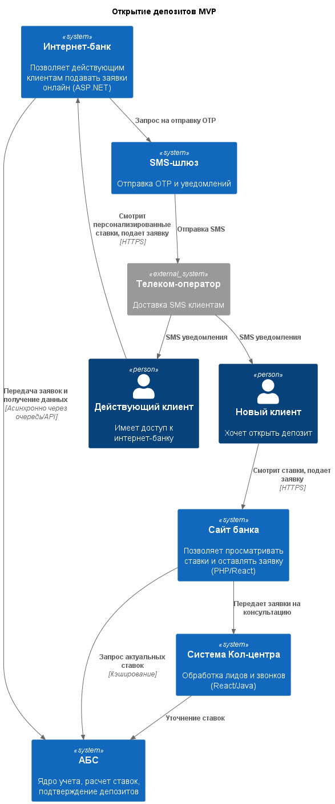
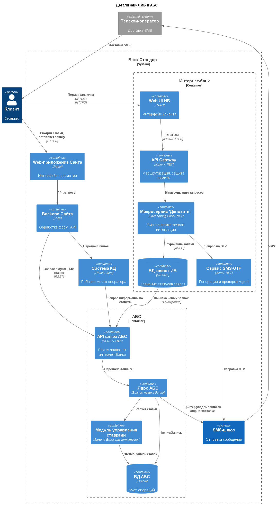

### **Название задачи:** Архитектура MVP по открытию депозитов в цифровых каналах
### **Автор:** Команда цифровой трансформации
### **Дата:** 19.11.2026

### **Функциональные требования**

|**№**|**Действующие лица или системы**|**Use Case**|**Описание**|
| :-: | :- | :- | :- |
| 1 | Новый клиент, Сайт | Подача заявки на депозит с сайта | 1. Клиент заходит на сайт банка. 2. Видит список депозитов с актуальными ставками. 3. Заполняет форму: ФИО, номер телефона. 4. Отправляет заявку. |
| 2 | Менеджер кол-центра, Система КЦ | Обработка заявки с сайта | 1. Менеджер видит заявку в системе КЦ. 2. Изучает данные клиента. 3. Звонит клиенту, консультирует, может предложить особые условия. 4. Назначает время визита в отделение для идентификации. |
| 3 | Действующий клиент, Интернет-банк | Просмотр персонализированных ставок | 1. Клиент авторизуется в ИБ. 2. Видит базовые ставки и индивидуальные предложения (на основе данных из АБС). |
| 4 | Действующий клиент, Интернет-банк | Подача заявки на открытие депозита | 1. Выбирает счет списания и сумму депозита. 2. Нажимает «Открыть». 3. Подтверждает операцию СМС-кодом. 4. Заявка уходит в обработку. |
| 5 | Бэк-офис депозитов, АБС | Обработка заявки на этапе MVP | 1. Сотрудник бэк-офиса видит заявку из ИБ/сайта в АБС. 2. Проверяет условия и подтверждает ставку в АБС. 3. АБС инициирует отправку СМС клиенту об одобрении. |
| 6 | Клиент, SMS-шлюз, АБС | Получение уведомлений | 1. После подтверждения ставки клиент получает СМС. 2. После фактического открытия депозита клиент получает СМС с реквизитами. |
| 7 | Бэк-офис (депозиты/кредиты), АБС | Управление ставками | 1. Сотрудники работают с таблицей ставок. 2. Данные переносятся из XLS-файлов в новую БД/модуль АБС. 3. Расчет ставок автоматизируется. |

### **Нефункциональные требования**
*За основу взяты архитектурно-значимые требования из FURPS+.*

|**№**|**Требование**|
| :-: | :- |
| 1 | **Безопасность:** Шифрование трафика (HTTPS/TLS) при передаче ПДн. |
| 2 | **Изоляция нагрузки:** Запрет прямой синхронной работы ИБ с API/БД АБС в новом процессе. База АБС перегружена, любые пики приведут к отказу. |
| 3 | **Производительность:** Отклик интерфейса — миллисекунды. Требуется кэширование справочников (ставок, счетов). |
| 4 | **Масштабируемость:** Горизонтальное масштабирование ИБ и распределение нагрузки между серверами. АБС масштабируется только вертикально. |
| 5 | **Надежность (SLA 99.9%):** Отказоустойчивость ИБ. При сбое основного ЦОД сервисы ИБ должны оставаться доступными (геораспределение). |
| 6 | **Технологический стек:** Использование существующих СУБД и экспертизы. Kafka — как перспективная очередь, но требует обхода текущих ограничений монолита ИБ. |
| 7 | **Импортозамещение/Разработка:** СМС-функционал реализуется силами команды банка. |

### **Решение**

Для реализации MVP предлагается использовать **событийно-ориентированную архитектуру с внедрением паттерна API Gateway и выделением микросервиса Депозитов**.

**Какие команды участвуют:**
1. **Команда Интернет-банка:** Разработка нового микросервиса «Депозиты», настройка API Gateway, доработка фронтенда ИБ.
2. **Команда АБС:** Разработка REST API/SOAP сервисов для приема заявок, создание модуля хранения и расчета ставок (замена XLS), настройка триггеров СМС.
3. **Команда Сайта:** Добавление формы заявки и вывод актуальных ставок (через API Gateway).
4. **Команда Системы КЦ:** Настройка экрана отображения новых заявок с сайта.
5. **Команда Цифровой трансформации:** Координация, дизайн-система, написание ТЗ.

**Логика принятия решений:**
*   Чтобы защитить АБС от перегрузки, мы **не** разрешаем ИБ делать прямые запросы к базе АБС.
*   Между ИБ и АБС встраивается **API Gateway (или Message Broker)**. ИБ отправляет заявку в виде асинхронного сообщения (через Kafka или очередь на базе MS SQL). АБС забирает сообщения с той скоростью, которую выдерживает ее Oracle. Это сглаживает пиковые нагрузки.
*   Логика работы с СМС (генерация OTP для подписания заявки) выносится в отдельный микросервис внутри контура ИБ (на Java/.NET). Это обходит ограничение ядра ИБ и зависимость от подрядчика.
*   Ставки переносятся из XLS в отдельные справочники в АБС (Oracle). Для кэширования актуальных ставок на Сайте и в ИБ используется Redis или аналогичное решение.

**C4 Диаграммы:**
*   **C4 Диаграмма контекста (Level 1):**

*   **C4 Диаграмма контейнеров (Level 2):**

### **Альтернативы**
1.  **Прямая интеграция интернет-банка с API АБС:**
    *   *Недостаток:* Высокий риск отказа АБС из-за перегрузки БД. Невозможность горизонтального масштабирования. Нарушает нефункциональные требования.
2.  **Реализация всего функционала депозитов внутри монолита АБС:**
    *   *Недостаток:* Невозможность быстро выпускать обновления интерфейса для клиентов.
3.  **Использование Kafka сразу в MVP:**
    *   *Недостаток:* Текущая версия платформы ИБ несовместима с Kafka. Для внедрения потребуется полный рефакторинг ИБ, что не вписывается в сроки MVP. *Решение: используем базу данных MS SQL как промежуточную очередь, с перспективой перехода на Kafka.*

**Недостатки, ограничения, риски**
*   **Риск 1:** АБС масштабируется только вертикально. В случае аномального роста заявок очередь может расти быстрее, чем АБС сможет обрабатывать заявки.
*   **Риск 2:** Текущая версия интернет-банка устарела. Выделение микросервиса депозитов потребует настройки сложной маршрутизации на уровне API Gateway.
*   **Ограничение:** Новый клиент с сайта все равно обязан прийти в отделение. Это законодательное требование, MVP не может его обойти. 
*   **Ограничение:** Взаимодействие бэк-офиса кредитов и депозитов по-прежнему может требовать ручных действий, если требования безопасности запрещают им видеть данные друг друга напрямую в одном интерфейсе.