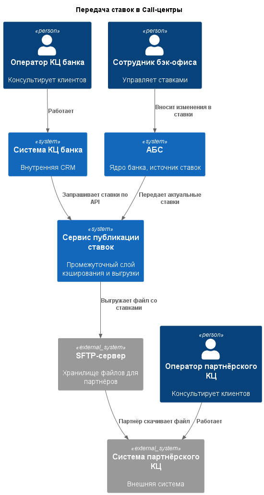
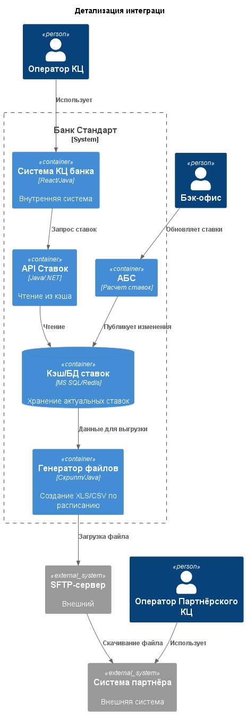

### **Название задачи:** Обеспечение Call-центров актуальными ставками по депозитам
### **Автор:** Команда цифровой трансформации
### **Дата:** 20.11.2026

### **Функциональные требования**

|**№**|**Действующие лица или системы**|**Use Case**|**Описание**|
| :-: | :- | :- | :- |
| 1 | Сотрудник кол-центра банка, Система КЦ | Просмотр актуальных ставок | Оператор КЦ принимает входящий звонок от клиента и видит в своей системе актуальные базовые ставки по депозитам для консультации. |
| 2 | Сотрудник партнёрского КЦ, Внешняя система | Просмотр актуальных ставок | Партнёрский КЦ получает файл со ставками по SFTP. Оператор открывает файл или систему и консультирует клиента по актуальным условиям. |
| 3 | Бэк-офис депозитов, АБС | Обновление ставок | Сотрудник бэк-офиса вносит изменения в ставки в АБС. Система автоматически обновляет данные для внутреннего КЦ и формирует новый файл для партнёрского КЦ. |

### **Нефункциональные требования**

|**№**|**Требование**|
| :-: | :- |
| 1 | **Интеграция:** Передача данных партнёрскому КЦ должна осуществляться исключительно через SFTP, так как API-вызовы невозможны. |
| 2 | **Производительность:** Доступ к ставкам из Системы КЦ должен быть быстрым, чтобы не задерживать оператора на линии. Прямые запросы к БД АБС запрещены. |
| 3 | **Актуальность:** Данные о ставках должны обновляться не реже одного раза в сутки. |
| 4 | **Безопасность:** Передача файлов партнёру должна осуществляться по защищённому протоколу с использованием ключей аутентификации. |

### **Решение**

Для решения задачи предлагается использовать паттерн **«Публикация данных» (Data Publishing)**. АБС остаётся единственным источником истины для ставок, но доступ к ним для смежных систем организуется через промежуточный сервис/хранилище.

**Логика принятия решений:**
1.  **Внутренний КЦ:** Чтобы избежать перегрузки АБС прямыми запросами, данные о ставках кэшируются в промежуточном хранилище. Система КЦ делает запрос к этому промежуточному слою.
2.  **Партнёрский КЦ:** Так как API запрещено, настраивается **SFTP-сервер**. По расписанию (например, каждую ночь или при изменении ставок) из АБС или промежуточного слоя генерируется файл с актуальными ставками, который выгружается на SFTP.
3.  **Удобство (Elderly Care):** Операторы обоих КЦ получают простой и быстрый доступ к данным, чтобы снизить время ожидания клиентов на линии.

**C4 Диаграммы:**
* **C4 Диаграмма контекста (Level 1):**

* **C4 Диаграмма контейнеров (Level 2):**

### **Альтернативы**
1.  **Прямая интеграция Системы КЦ с БД АБС (SQL):**
    *   *Недостаток:* Нарушает безопасность и создаёт нагрузку на и без того перегруженную БД АБС. Высокий риск падения системы.
2.  **Написание API для партнёрского КЦ:**
    *   *Недостаток:* Невозможно реализовать из-за технических ограничений партнёра.
3.  **Ручная выгрузка файлов оператором:**
    *   *Недостаток:* Высокий риск человеческой ошибки и задержки в актуализации данных.

**Недостатки, ограничения, риски**
*   **Риск 1:** Файл на SFTP может не обновиться из-за сбоя скрипта. *Митигация:* Настроить мониторинг.
*   **Ограничение:** Задержка актуальности данных у партнёрского КЦ. Для MVP это допустимо.